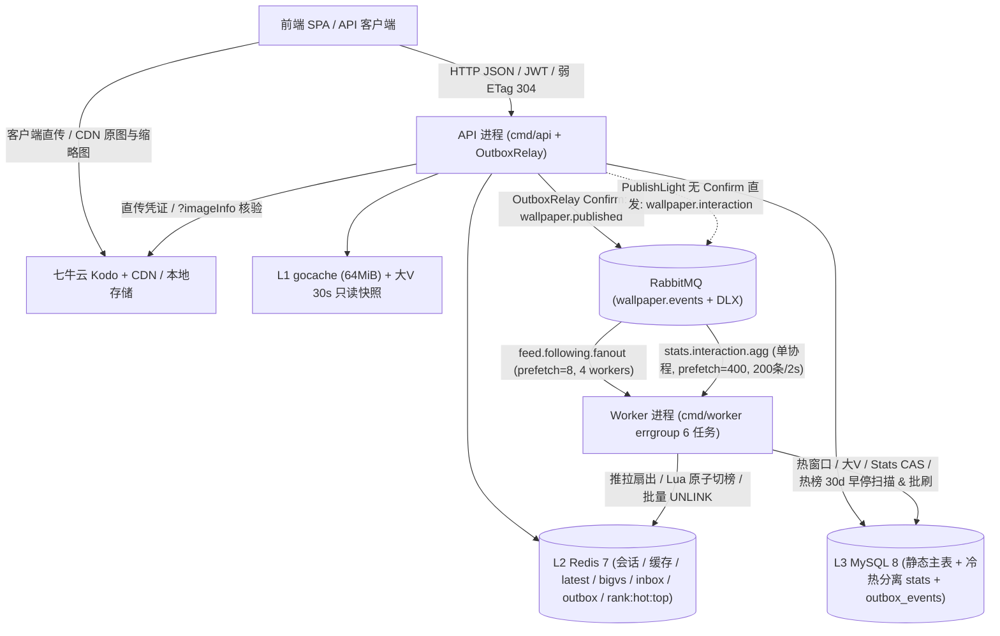

# WallFlow · 高清壁纸社区 Go 后端

> 面向 **2 核 2G 单机（7 容器共存）** 极限压榨的高并发壁纸画廊与轻社区后端：自研 L1 进程内缓存 + 三级缓存、推拉结合关注流、RabbitMQ 窗口聚合写削峰、重力衰减热门榜与弱 `ETag` `304` 短路。

[](https://go.dev/)
[](https://github.com/gin-gonic/gin)
[](https://www.mysql.com/)
[](https://redis.io/)
[](https://www.rabbitmq.com/)
[](https://wall.kirep.top)

- **线上演示**：<https://wall.kirep.top>
- **核心技术栈**：Go `1.24` · Gin · GORM (MySQL 8) · `go-redis/v9` (Redis 7) · `amqp091-go` (RabbitMQ 3.13) · 自研 L1 缓存 [`gocache`](https://github.com/Kirep-06/gocache) · JWT (HS256) · 七牛云 Kodo / 本地存储双驱动 · `singleflight` / `errgroup`

## 架构拓扑



## 核心亮点速览

- **三级缓存与防击穿（L1 `gocache` + L2 Redis + L3 MySQL）**：泛型 `MultiLevel[T]` 封装 `L1 → L2 → singleflight L3` 读路径与批量 `MGet` 消灭列表 N+1；采用冷热分层 TTL（±10% 抖动防雪崩）、空值标记防穿透与写库后失效策略；发现页最新流经永不过期 `feed:latest`（最新 1,000 条）热窗口承接，不足时无缝回源 MySQL。
- **推拉结合关注流（Transactional Outbox + 最大堆 K 路归并）**：投稿与 `outbox_events` 同事务原子提交，经 `FOR UPDATE SKIP LOCKED` + Publisher Confirm 强可靠投递；普通作者写扩散至活跃粉丝 `feed:inbox:{uid}`，达 1,000 粉原子晋升大 V 改走个人 `feed:outbox:{author_id}` 读扩散；读取时 Redis Pipeline 拉取后在 Go 侧完成最大堆 K 路归并、哨兵 `"0"` 防穿透与安全水位线冷补查。
- **高频互动写削峰（RabbitMQ 窗口聚合零丢数）**：将高频计数拆出静态主表形成 `wallpaper_stats`；下载/点赞/收藏/评论增量经 `PublishLight` 无 Confirm 通道直发，`InteractionAggConsumer` 单协程零锁按「满 200 条或 2s」合并并按 `wallpaper_id ASC` 执行防下溢批量刷盘 + 批量 `UNLINK` L2 + `Ack(true)`，停机时 `ch.Cancel` + `context.WithoutCancel` 同步完成最终 Flush 零丢数，辅以低频 `StatsReconciler`（10s 冷静窗口 + `updated_at` CAS）兜底对账。
- **热门榜重力衰减 + 弱 `ETag` `304` 短路**：零侵入写链路，Worker 每 5 分钟按 `idx_status_id` 倒序早停扫描近 30 天候选，恒定内存归约 Top 100 并通过 Lua 原子切换 `rank:hot:top` 与单调版本号 `rank:hot:version`；API 首屏基于弱 `ETag`（`W/"hot-<ver>-l<limit>-u<viewerID>"`）在 Redis Lua 侧直接短路返回 `304 Not Modified`，节省 100% 下行带宽。

## 真机压测数据（2 核 2G 阿里云 ECS · 7 容器共存）

> **测试口径**：阿里云 ECS（2 vCPU / 2GB 内存 + 2GB Swap / 40GB 云盘，Alibaba Cloud Linux 3），**MySQL 8 + Redis 7 + RabbitMQ 3.13 + Go API + Go Worker + Nginx + Caddy 共 7 容器同机运行**；库内 **50,000** 条壁纸/图片/统计与 **1,000** 名用户。压测端在 ECS 本机回环施压 `http://127.0.0.1:8080`（绕开 3Mbps 公网带宽，且压测端与 7 容器共享 2 核 CPU，实测为**保守下界**），每组 2s 预热 + 10s 正式采样。全场景 **0 错误率**、无 OOM，压后宿主机剩余可用内存 **704 MiB**（Worker 预热实测：`feed:latest` 16.1ms、`rank:hot:top` 207.4ms）。

| 场景 | 接口与模式 | 并发 | QPS | Avg | P50 | P95 | P99 | 平均 Body | 校验 / 收益 |
|---|---|---:|---:|---:|---:|---:|---:|---:|---|
| **发现流（热窗口 + 三级缓存）** | `GET /api/v1/wallpapers?limit=20` | 50 | **874.6** | 56.89ms | 52.97ms | 95.65ms | **129.30ms** | 23.4 KB | 较回源 DB 吞吐 **2.11x**，P99 **-54.1%** |
| **发现流（热窗口 + 三级缓存）** | `GET /api/v1/wallpapers?limit=20` | 100 | **949.6** | 104.65ms | 99.03ms | 162.27ms | 215.59ms | 23.4 KB | `200` (0 err) |
| **发现流（关闭热窗口直查 DB）** | `GET /api/v1/wallpapers?limit=20` | 50 | **414.2** | 120.13ms | 104.52ms | 223.67ms | **281.81ms** | 23.4 KB | 对照基线 |
| **热门榜（200 全量 JSON）** | `GET /api/v1/feed/hot?limit=20` | 50 | **701.8** | 71.10ms | 65.61ms | 123.08ms | **155.17ms** | 24.1 KB | `200` (0 err) |
| **热门榜（弱 ETag `304` 短路）** | `GET /api/v1/feed/hot?limit=20` + `If-None-Match` | 50 | **4,118.8** | 12.13ms | 10.67ms | 21.91ms | **31.53ms** | **0 B** | 吞吐 **5.87x**，P99 **-79.7%**，省 **100%** 带宽 |
| **热门榜（弱 ETag `304` 短路）** | `GET /api/v1/feed/hot?limit=20` + `If-None-Match` | 100 | **4,364.9** | 22.88ms | 20.65ms | 42.03ms | **57.52ms** | **0 B** | `304` (0 err) |
| **热点壁纸详情（L1 `gocache`）** | `GET /api/v1/wallpapers/50000` | 50 | **4,329.2** | 11.54ms | 9.58ms | 24.13ms | **35.59ms** | 1.3 KB | `200` (0 err) |
| **热点壁纸详情（L1 `gocache`）** | `GET /api/v1/wallpapers/50000` | 100 | **5,048.0** | 19.77ms | 16.07ms | 39.95ms | **60.10ms** | 1.3 KB | 完全隔离 MySQL 读压 |
| **单图热点高频写削峰（MQ 聚合）** | `POST /api/v1/wallpapers/50000/download` | 50 | **1,743.4** | 28.66ms | 24.16ms | 57.90ms | **88.81ms** | 33 B | **17,480 / 17,480 零丢数** |
| **关注流推拉结合 K 路归并** | `GET /api/v1/feed/following?limit=20`（50 普通 + 5 大 V） | 50 | **259.5** | 191.36ms | 178.49ms | 314.26ms | **390.90ms** | 22.3 KB | 含 JWT 鉴权；首次冷重建 **159.2ms** |
| **关注流推拉结合 K 路归并** | `GET /api/v1/feed/following?limit=20`（50 普通 + 5 大 V） | 100 | **256.0** | 387.94ms | 363.61ms | 614.30ms | 799.96ms | 22.3 KB | 2 核拐点稳定，无塌陷 |

### 一键复现本地对照压测（`cmd/bench`）

仓库内置压测与造数工具 `cmd/bench`，默认运行在隔离库 `wallpaper_feed_bench`、Redis DB `1` 与 RabbitMQ vhost `/bench`，不污染开发数据：

```bash
# 1. 启动基础设施（在全栈根目录执行，或连接你本地的 MySQL 8 / Redis 7 / RabbitMQ）
docker compose up -d mysql redis rabbitmq

# 2. 创建压测专用 RabbitMQ vhost（首次执行一次）
docker exec wallflow-rabbitmq-1 rabbitmqctl add_vhost /bench
docker exec wallflow-rabbitmq-1 rabbitmqctl set_permissions -p /bench wallflow ".*" ".*" ".*"

# 3. 一键建库、灌入 30,000 条壁纸并执行读/写/关注流三组对照压测
go run ./cmd/bench -mode=all

# 可选：按需单独清理、造数或重跑指定压测套件
go run ./cmd/bench -mode=clean
go run ./cmd/bench -mode=seed -wallpapers=30000
go run ./cmd/bench -mode=run -suites=read,write,feed
```

## 快速启动

### 方式一：Docker Compose 一键拉起全栈（推荐）

在上层全栈工作区根目录执行（首次启动会自动执行 `migrations/001~009*.sql` 初始化表结构）：

```bash
docker compose up -d --build
# 后端健康检查：http://127.0.0.1:8080/healthz
# RabbitMQ 控制台：http://127.0.0.1:15672
```

### 方式二：本地运行 Go 服务

1. **准备配置与环境变量**（敏感密钥仅经环境变量注入，不写入 YAML）：
   ```bash
   cp configs/config.example.yaml configs/config.local.yaml
   cp .env.example .env
   # 在 .env 中设置至少 32 字节的 WF_AUTH_JWT_SECRET
   # 默认 storage.provider=noop、rabbitmq.enabled=false，无需七牛或 MQ 即可启动联调
   ```
2. **初始化 MySQL 8 表结构**：
   ```bash
   # 创建 wallpaper_feed 库后，按编号顺序执行迁移脚本
   for f in migrations/00*.sql; do mysql -u root -p wallpaper_feed < "$f"; done
   ```
3. **启动 API / Worker 与运行单元测试**：
   ```bash
   # 启动 API 服务（默认 :8080，内置 OutboxRelay）
   go run ./cmd/api

   # 启动 Worker 进程（6 项周期对账/热榜快照与 MQ 消费者）
   go run ./cmd/worker

   # 运行编译检查与离线单元测试（使用 miniredis 与内存 stub，无需外部依赖）
   go build ./...
   go test ./...
   ```

## 目录结构

```text
backend/
├── cmd/
│   ├── api/                 # API 进程入口（配置装配、OutboxRelay 托管、有序优雅关闭）
│   ├── worker/              # Worker 进程入口（errgroup 并行托管 4 类对账/快照 + 2 类 MQ 消费者）
│   └── bench/               # 隔离环境造数与读/写/关注流对照压测工具
├── configs/
│   └── config.example.yaml  # YAML 配置模板（默认 noop 存储与关闭 MQ，便于零门槛启动）
├── migrations/              # 001 ~ 009 顺序 SQL 迁移脚本（users / wallpapers / follows / outbox / interactions / images）
├── Dockerfile               # 多阶段静态编译镜像（同时产出 /app/api 与 /app/worker）
└── internal/
    ├── app/                 # 依赖装配（fail-fast 纯内存组件前置初始化 + 基础设施装配）
    ├── config/              # Viper YAML 加载、.env 注入与密钥/MQ/存储配置校验
    ├── infra/               # MySQL (GORM) 与 Redis 客户端初始化、探活及优雅关闭
    ├── mq/                  # RabbitMQ 双通道客户端（Confirm 强可靠 + PublishLight 轻量直发 + 拓扑声明）
    ├── cache/               # 泛型 MultiLevel[T] 三级缓存、LatestFeed、BigVSet、FollowingFeed 与 HotRank Lua
    ├── storage/             # StorageService 抽象、七牛云 Kodo 直传/?imageInfo 核验、Local 与 Noop 驱动
    ├── middleware/          # Recovery、RequestLog、CORS（放行 If-None-Match / 暴露 ETag）、JWT 鉴权
    ├── model/               # 领域实体与热门榜重力衰减纯算分算法
    ├── repository/          # MySQL / Redis 数据访问层与并发防死锁/防下溢测试
    ├── service/             # Auth / User / Upload / Wallpaper / Follow / Feed / Interaction / AdminMeta 领域服务
    ├── handler/             # Gin 路由注册（32 个 REST 接口）与 HTTP 处理器
    ├── worker/              # OutboxRelay、4 类周期对账/热榜快照任务、Fanout 与 InteractionAgg 消费者
    └── pkg/                 # cursor 游标、errno 统一错误码、jwtutil、response 统一信封
```
